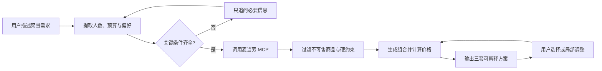

# 麦麦聚餐决策官｜参赛方案 V0.1

> 面向 WaytoAGI 1024「用餐」赛道与麦当劳程序员创意开发大赛的双赛道方案
>
> 整理日期：2026-10-24

## 1. 一句话方案

用户用自然语言告诉我们人数、预算、口味、忌口和用餐偏好，Skill 调用麦当劳 MCP 获取真实商品、价格与活动信息，生成 2～3 套可解释、可执行的聚餐点单方案。

## 2. 为什么选这个方向

普通菜单查询只能告诉用户“有什么”，而多人聚餐真正困难的是同时平衡预算、人数、口味和份量。本方案把麦当劳 MCP 的实时信息转化为一份具体的决策结果，能够直接展示 MCP 调用价值。

这个方向适合比赛的原因：

- 痛点真实：多人点餐时经常有人不吃辣、有人想吃小食、预算又有限；
- 演示直观：一句自然语言输入，马上得到商品明细、总价、人均价和推荐理由；
- MCP 不可替代：门店、菜单、价格、可售状态和活动信息需要实时查询；
- 容易形成闭环：理解需求 → 查询真实信息 → 组合计算 → 输出方案 → 用户调整；
- 可以快速做出 MVP，也有足够空间继续增加优惠优化、购物车和真实用户反馈。

## 3. 目标用户

- 2～8 人的同事、同学和朋友聚餐；
- 有固定总预算，希望快速完成点餐的人；
- 需要同时照顾吃辣、忌口、饮料、小食等差异的人；
- 想比较“最省钱”“更均衡”“更丰富”方案的人。

## 4. 核心场景

推荐作为比赛主 Demo 的输入：

> 学生党 4 人，预算 100 元，2 人不吃辣，1 人想吃鸡翅，尽量有饮料，帮我配一套。

Skill 输出三种不同侧重点的方案：

1. **最省钱**：优先控制总价，满足所有硬约束；
2. **均衡饱腹**：兼顾主食、份量和饮料；
3. **丰富分享**：增加适合多人分享的小食或新品。

每套方案展示：

- 商品与数量；
- 预计总价和人均价；
- 使用的优惠及节省金额（接口能够确认时）；
- 每位成员可以怎么分；
- 满足了哪些条件、做了哪些取舍；
- 当前门店、价格和可售状态的提示。

## 5. MVP 范围

第一版只完成一个稳定、可录屏的闭环：

1. 从自然语言提取人数、预算、口味、忌口和品类偏好；
2. 必要时让用户选择门店或提供位置范围；
3. 调用麦当劳 MCP 获取真实菜单、商品、价格和可售状态；
4. 过滤违反硬约束的商品；
5. 生成候选组合并计算总价、人均价；
6. 输出 2～3 套差异明显的方案；
7. 支持“换成无糖饮料”“再便宜 10 元”“增加 1 人”等局部调整。

MVP 暂不承诺自动支付、自动提交订单、退款、完整营养建议，以及 MCP 实际工具列表中不存在的能力。

**交付形态：命令行 + 网页双入口。** 同一套规划逻辑（`src/meal_planner.py`）同时服务两种入口：

- **命令行**（`python src/meal_planner.py ...`）：适合开发调试与能力验证；
- **网页版**（`python web/server.py`，默认 `http://127.0.0.1:8808`）：零第三方依赖（仅 Python 标准库），浏览器打开即用，支持预算/人数/取餐方式/结构份数/忌口的表单输入，结果页展示门店信息、分组明细、实付总价、预算剩余与费用拆分。

网页版还内置「按结构求最低价」能力：用户指定主食/小吃/甜品/饮品各几份，系统在满足全部份数的前提下求实付总价最低的组合，预算配不齐时如实给出最低所需金额而非硬凑。三场景实跑记录见 `docs/RUN_RECORD.md`，使用说明见 `docs/USAGE.md` 第 4 节。

## 6. 产品流程



## 7. 需求与约束模型

| 字段 | 类型 | 示例 | 处理方式 |
|---|---|---|---|
| 人数 | 必填 | 4 人 | 缺失时追问 |
| 总预算 | 必填 | 100 元 | 缺失时追问或提供预算档位 |
| 门店/位置 | 条件必填 | 上海徐家汇附近 | 调用实时菜单前确认 |
| 口味 | 可选 | 爱吃辣、牛肉优先 | 作为软偏好 |
| 忌口 | 可选 | 2 人不吃辣 | 作为硬约束 |
| 必选品类 | 可选 | 必须有饮料 | 作为硬约束 |
| 想吃品类 | 可选 | 想吃鸡翅 | 优先满足并解释取舍 |
| 用餐方式 | 可选 | 到店取餐 | 接口需要时再追问 |
| 推荐目标 | 可选 | 最省钱、吃得丰富 | 调整评分权重 |

“不能超过 100 元”“不吃辣”“必须有饮料”属于硬约束；“最好有甜品”“尽量丰富”属于软偏好。没有可行解时必须明确指出冲突，并建议放宽哪一个条件。

## 8. 组合与排序方法

MVP 使用“规则过滤 + 小规模组合 + 加权评分”：

1. 按主食、小食、饮料和甜品分类；
2. 删除不可售或违反硬约束的商品；
3. 每类保留若干高相关候选，生成有限组合；
4. 根据 MCP 返回的价格和优惠计算预计总价；
5. 删除超预算组合；
6. 对剩余组合评分并去重；
7. 选出侧重点不同的前三套方案。

建议默认评分：

```text
总分 = 预算匹配度 × 35%
     + 偏好匹配度 × 25%
     + 份量合理度 × 20%
     + 优惠收益 × 15%
     + 新品或趣味性 × 5%
```

当用户明确说“越便宜越好”时，提高预算匹配度和优惠收益权重。

## 9. MCP 集成原则

- 必须读取并使用麦当劳 MCP 当前提供的真实工具列表；
- 不在代码和文档中臆造具体 Tool 名称；
- 优先验证门店、菜单、商品详情、价格、可售状态和活动能力；
- 在 `MCP_INTEGRATION.md` 中记录实际 Server、Tool、参数、调用流程和业务价值；
- MCP 没有返回的数据不得编造；
- MCP Token 只放在安全配置或环境变量中，禁止提交到 GitHub。

脱敏配置示例应使用环境变量占位符：

```json
{
  "mcpServers": {
    "mcd-mcp": {
      "type": "streamablehttp",
      "url": "https://mcp.mcd.cn",
      "headers": {
        "Authorization": "Bearer ${MCD_MCP_TOKEN}"
      }
    }
  }
}
```

## 10. 建议输出格式

```text
方案 A｜最省钱
- 商品与数量：……
- 预计总价：¥……
- 人均：¥……
- 分配建议：……
- 推荐理由：……
- 约束满足：预算内 / 有饮料 / 2 人可选不辣

方案 B｜均衡饱腹
……

方案 C｜丰富分享
……

我的首选：方案 B
原因：……

以上价格和可售状态来自当前 MCP 返回或基于返回数据计算，最终以下单页面为准。
```

## 11. 比赛演示脚本

建议将录屏控制在 90 秒左右，**先网页、后命令行**——网页直观，命令行说明真实算价链路：

1. **10 秒：打开网页**——`python web/server.py`，浏览器进入 `http://127.0.0.1:8808`，展示输入界面；
2. **15 秒：结构配餐**——预算 100，结构 1 主食 + 1 小吃 + 1 甜品 + 1 饮品，城市绍兴、关键词上虞，点击提交；
3. **20 秒：展示 ¥35 最低价组合**——牛肉堡单品精选 ¥13.50 / 苹果片 ¥7.00 / 灰焰圆筒 ¥5.00 / 雪碧 ¥9.50，实付 ¥35.00、预算剩余进度条与费用拆分；
4. **15 秒：切「帮我搭配」**——预算 130，展示 3 个方案卡片，各有商品明细和人均价；
5. **15 秒：故意配不齐**——结构改 2 主食 + 2 小吃，预算降到 20，展示「⚠ 配不齐：最低所需 ¥41.00、还差 ¥21.00」——**这一步最能体现"不糊弄"**；
6. **15 秒：命令行佐证**——跑 `python web/test_consistency.py`（6/6 通过），并展示一次 `src/meal_planner.py` 调用，说明网页与命令行共用同一套 `meal_planner.py`、同一套真实 MCP 算价链路。

以上三场景的真实返回数据已留档于 `docs/RUN_RECORD.md`。

如果时间允许，再找 3～5 位真实用户试用，将反馈和修改前后对比写入 README。WaytoAGI 评审明确提到“有人真的用过”会加分。

## 12. 双赛道交付清单

### WaytoAGI 1024 用餐赛道

- [ ] 可运行作品链接、GitHub 仓库或安装包（含命令行 `src/` + 网页版 `web/`，`python web/server.py` 即可运行）；
- [ ] 使用说明或演示录屏（`docs/USAGE.md`，含两种用法与真实输出）；
- [ ] 网页版三场景实跑记录（`docs/RUN_RECORD.md`：结构 ¥35.00 / 默认 3 方案 / ¥41.00 配不齐如实说明）；
- [ ] 真实调用麦当劳 MCP；
- [ ] 使用 WorkBuddy 开发并提交 `workbuddy.md`，以参与用餐赛道前三评选；
- [ ] 2026-10-25 16:00 前正式提交。

### 麦当劳程序员创意开发大赛

- [ ] Public GitHub 仓库；
- [ ] `README.md`；
- [ ] 官方原版 `CONTEST_DECLARATION.md`，内容不得修改；
- [ ] `MCP_INTEGRATION.md`；
- [ ] `mcp-config.example.json`，只放环境变量占位符；
- [ ] 可运行源代码（命令行 `src/` + 零依赖网页 `web/` + 一致性测试 `web/test_consistency.py`）；
- [ ] `workbuddy.md`（参加 WorkBuddy 奖励时）；
- [ ] 在官方仓库按格式发布报名 Issue；
- [ ] 2026-10-25 23:59 前完成报名。

## 13. 队友分工建议

| 角色 | 当天优先任务 | 交付物 |
|---|---|---|
| MCP/后端 | 申请 Token、验证工具、封装真实调用 | 工具清单、调用代码、`MCP_INTEGRATION.md` |
| Skill/算法 | 需求提取、组合生成、评分与异常处理 | `SKILL.md`、组合逻辑、示例结果 |
| 前端/交互 | 搭建最小对话或结果展示页 | 可访问 Demo、方案卡片 |
| 内容/提交 | README、录屏、用户试用、双赛道材料 | README、视频、`workbuddy.md`、报名材料 |

人手较少时，优先顺序是：MCP 跑通 → 核心推荐闭环 → 录屏 → 参赛文件 → 页面美化。

## 14. 当天里程碑

- **T+1 小时**：Token 和 MCP 连接完成，确认实际工具列表；
- **T+3 小时**：真实菜单查询与结构化返回跑通；
- **T+6 小时**：输入、组合、评分、输出形成完整闭环；
- **T+8 小时**：完成主 Demo 页面或对话体验；
- **T+10 小时**：补齐文档、脱敏检查和 `workbuddy.md`；
- **提交前**：录屏、找真实用户试用、核验两个赛道的材料与截止时间。

## 15. 现在需要队友确认的决定

1. 项目正式名称使用“麦麦聚餐决策官”还是仓库原方案“麦门省钱搭子”；
2. MVP 使用纯 WorkBuddy Skill，还是增加一个可公开访问的轻量网页；
3. 是否把真实购物车操作纳入演示；如果时间紧，只展示下单前确认清单；
4. 谁负责申请 MCP Token 并尽快共享脱敏后的真实 Tool 列表；
5. 谁负责最终 GitHub Issue 和 WaytoAGI 作品提交。

## 16. 官方参考

- WaytoAGI 用餐赛道：<https://1024.waytoagi.com/tracks/dine>
- 麦当劳程序员创意开发大赛：<https://github.com/M-China/mcd-developer-innovation-challenge>
- 麦当劳大赛完整规则：<https://github.com/M-China/mcd-developer-innovation-challenge/blob/main/activityGuidelines.md>
- 麦当劳 MCP：<https://open.mcd.cn/mcp>

